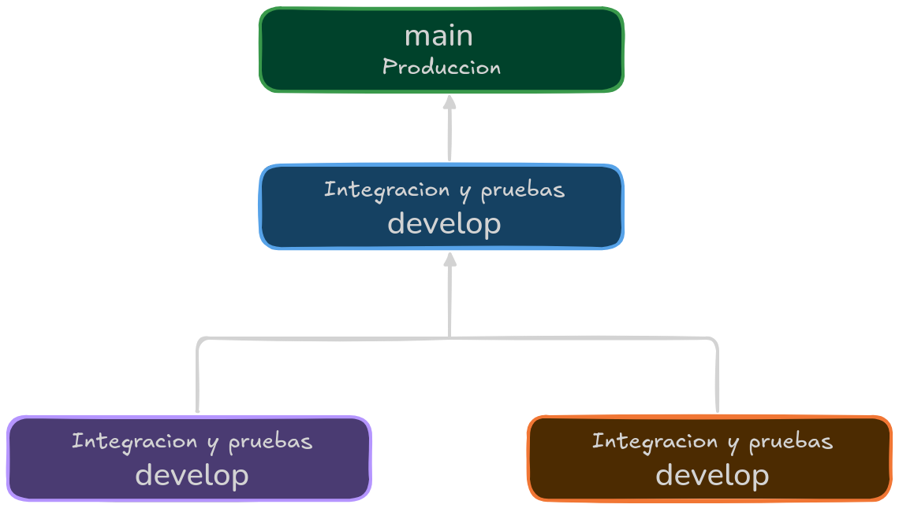

# SmartBiz

MVP local de gestion para pequenas empresas: catalogo, consulta de existencias y venta en efectivo conectada al inventario. Implementacion funcional derivada de `Docs`, no del nombre del producto ni de un dashboard ficticio.

## Alcance

Autenticacion individual, roles administrador/cajero/bodeguero, categorias, alta y busqueda de productos, carrito editable, cobro con cambio, venta atomica con movimientos de inventario, historial y comprobante descargable TXT/imprimible. Datos reales en MongoDB, semilla ficticia identificada y persistente entre reinicios.

El corte sigue las seis HU propuestas en D06 §6 y agrega pago en efectivo y comprobante como dependencias. No entrega todo el ERP: pedidos, compras, devoluciones, empleados CRUD, gastos y reportes financieros estan pendientes. No incluye ML, cobro bancario ni facturacion electronica. La aceptacion academica del PO sigue pendiente.

## Arquitectura

`frontend/`: React 19 + TypeScript + Vite, CSS propio responsive. `backend/`: Java 21 + Spring Boot 3.4 + Spring Data MongoDB. `compose.yaml`: MongoDB 8.0 replica set de un nodo, volumen durable. Se respeta el stack explicito en los diagramas C4 incrustados en D05, en lugar de reemplazarlo por Node/SQLite.

Navegador → proxy Vite `/api` → Spring Boot → MongoDB rs0. Venta, detalle embebido, movimientos y descuento de stock se confirman juntos en transaccion. Importes COP enteros, precios calculados en servidor, hashes BCrypt y cookie HttpOnly/SameSite Strict con 30 minutos de inactividad.

## Requisitos Previos

- Java JDK 21 y Maven 3.8 o superior.
- Node.js 22.12+ (o Node 24/26) y npm. Verificado aqui con Node 26.7 y npm 11.19.
- Docker Engine y Docker Compose con permiso de acceso al daemon, o MongoDB 8 instalado localmente.
- Puertos libres: 27017 Mongo, 8080 API y 5173 interfaz.
- Internet para descargar dependencias la primera vez; no requiere servicios externos ni suscripciones para operar.

## Instalacion

Comandos desde la raiz del repositorio, Bash/Linux:

```bash
npm ci
npm --prefix frontend ci
cp .env.example .env
docker compose up -d --wait
```

Compose inicializa rs0 y espera PRIMARY mediante healthcheck. No ejecutar simultaneamente otro Mongo en 27017. Si Docker informa permiso denegado, habilitar su acceso conforme a la administracion del equipo, o usar la alternativa local siguiente; no requiere ejecutar la aplicacion como root.

`.env` esta ignorado por Git. Maven no lo carga automaticamente: exportarlo en cada terminal del backend. Las credenciales seed son publicas y exclusivamente de demostracion, no secretos de produccion.

## Arranque

Terminal del backend, desde raiz:

```bash
set -a
source .env
set +a
mvn -f backend/pom.xml spring-boot:run
```

Otra terminal, desde raiz:

```bash
npm --prefix frontend run dev -- --strictPort
```

Abrir **http://127.0.0.1:5173**. La API escucha en loopback **http://127.0.0.1:8080/api**; no es una pagina web. El proxy conserva `Origin` y cookies. No abrir archivos HTML directamente ni usar Vite preview como despliegue integrado de produccion.

Para ejecutar el backend compilado:

```bash
mvn -f backend/pom.xml package
java -jar backend/target/smartbiz-backend-0.0.1-SNAPSHOT.jar
```

Requiere las mismas variables exportadas. Para detener: Ctrl+C en cada terminal; `docker compose stop` detiene Mongo conservando volumen. `docker compose up -d --wait` lo inicia nuevamente. **No usar `down -v`** si se quieren conservar datos.

### Alternativa Sin Docker

Con `mongod` 8 instalado y disponible en PATH, desde raiz:

```bash
mkdir -p .local/mongo
mongod --dbpath .local/mongo --replSet rs0 --bind_ip 127.0.0.1 --port 27017
```

En otra terminal ejecutar una vez (tambien es idempotente):

```bash
npm run mongo:init
```

Despues arrancar backend y frontend como arriba. La ruta `.local/mongo` persiste; Ctrl+C detiene Mongo limpiamente. Replica set es indispensable, Mongo standalone no sirve para este flujo transaccional. Compose y esta alternativa son excluyentes sobre el mismo puerto.

## Variables

| Variable | Valor local / finalidad |
|---|---|
| MONGODB_URI | mongodb://localhost:27017/smartbiz?replicaSet=rs0 |
| PORT | 8080 |
| SERVER_ADDRESS | 127.0.0.1, no exponer externamente |
| SEED_DEMO | true para crear semilla ficticia idempotente; false por defecto del backend |
| COOKIE_SECURE | false solo en HTTP loopback, true con HTTPS |
| ALLOWED_ORIGINS | Lista exacta de origenes, ver .env.example |
| TEST_MONGODB_URI | Base exclusiva de pruebas, smartbiz_test por ejemplo |
| MONGOD_BINARY | Ruta a mongod solo para prueba de reinicio; por defecto mongod en PATH |

No incluir passwords de bases reales en Git. Mongo local no tiene autenticacion: restringido a loopback. Un despliegue publico necesita HTTPS, autenticar Mongo, proteccion de login, backups y revisiones adicionales; no es el objetivo de este MVP.

## Base De Datos

V001 se aplica al arrancar: colecciones, validadores de documentos, indices unicos y registro en `schema_migrations`. Si detecta datos existentes incompatibles, detiene arranque con diagnostico sin borrarlos. No hay migracion destructiva ni reset automatico.

Colecciones: `users`, `categories`, `products`, `sales` con items historicos, `movements` y `schema_migrations`. Referencias verificadas por servicios; Mongo no tiene FK SQL. Las ventas y usuarios no se eliminan. Modelo y contrato REST: [MVP_ARQUITECTURA](Docs/MVP_ARQUITECTURA.md), detalles de validacion: [backend/README](backend/README.md).

Seed opt-in `SEED_DEMO=true`: tres cuentas, categoria Demostracion y productos DEMO-001 Cafe (18000, 30 unidades), DEMO-002 Arroz (4500, 50) y DEMO-003 Agua (2500, 40). `$setOnInsert` evita reponer existencias, cambiar credenciales o borrar operaciones al reiniciar.

| Cuenta local | Cargo | Password local compartida |
|---|---|---|
| admin@smartbiz.local | Administrador | DemoSmartBiz2026! |
| caja@smartbiz.local | Cajero | DemoSmartBiz2026! |
| bodega@smartbiz.local | Bodeguero | DemoSmartBiz2026! |

### Respaldo Manual

Detener backend antes de copiar/restaurar para evitar escrituras concurrentes. Con Mongo activo por Compose, crear copia en el contenedor y extraerla:

```bash
docker compose exec -T mongo mongodump --db smartbiz --archive=/tmp/smartbiz-backup.archive --gzip
docker compose cp mongo:/tmp/smartbiz-backup.archive ./smartbiz-backup.archive
```

Para restaurar deliberadamente una copia sobre la base existente (sustituye las colecciones de esa base; conservar copia anterior primero):

```bash
docker compose cp ./smartbiz-backup.archive mongo:/tmp/smartbiz-backup.archive
docker compose exec -T mongo mongorestore --archive=/tmp/smartbiz-backup.archive --gzip --nsInclude='smartbiz.*' --drop
```

Reiniciar backend y comprobar catalogo/historial. Este procedimiento no fue ejecutado aqui por falta de acceso al daemon; no se afirma RTO, copia diaria automatica ni restauracion probada. Sin Docker usar las mismas herramientas MongoDB Database Tools locales. No versionar archivos de backup.

## Validacion

Mongo rs0 debe estar activo. Desde raiz:

```bash
TEST_MONGODB_URI='mongodb://localhost:27017/smartbiz_test?replicaSet=rs0' mvn -B -ntp -f backend/pom.xml clean verify
npm --prefix frontend run lint
npm --prefix frontend run typecheck
npm --prefix frontend run build
npx playwright install chromium
npm run test:e2e
```

E2E necesita backend activo con seed; Playwright inicia Vite si no esta ejecutandose. Usa datos nuevos y no borra la base. Usar base de demo, nunca datos reales. Sin TEST_MONGODB_URI las pruebas de integracion Java se omiten: no considerar eso evidencia de transacciones.

Prueba adicional de reinicio real, con JAR ya compilado y mongod local:

```bash
MONGOD_BINARY=/ruta/absoluta/a/mongod npm run test:persistence
```

Usa Mongo 27018/replica persist0 y backend 8081 separados, datos nuevos en directorio temporal, reinicia ambos y comprueba venta, stock y movimiento. Detiene solo procesos propios; conserva evidencia y muestra su ruta. Falla si los puertos estan ocupados.

Resultados ejecutados: **13 pruebas Java aprobadas, 3 E2E Chromium aprobadas, reinicio PASS, lint/tipos/build correctos**. Cobertura backend 95,31% lineas (JaCoCo HTML en `backend/target/site/jacoco/index.html`). `npm audit --omit=dev` frontend y audit raiz: 0 vulnerabilidades; audit completo frontend: **11 altas transitivas de desarrollo por picomatch**, sin version corregida disponible en el registro consultado. No ocultadas con overrides. Consultar [MVP_PRUEBAS](Docs/MVP_PRUEBAS.md) para resultados y limites.

## Demostracion Y Documentacion

Recorrido breve: admin crea categoria/producto de 1500 COP con 10 unidades → cajero agrega 2 y recibe 5000 → comprobante total 3000/cambio 2000 → inventario 8 → historial → reiniciar sin borrar volumen y verificar permanencia.

- [Analisis y trazabilidad](Docs/MVP_ANALISIS.md)
- [Arquitectura y API](Docs/MVP_ARQUITECTURA.md)
- [Alcance y pendientes](Docs/MVP_ALCANCE.md)
- [Pruebas y limitaciones](Docs/MVP_PRUEBAS.md)
- [Guion reproducible](Docs/MVP_DEMO.md)

Trabajo local en `mvp/backend`, compatible con patron `*/backend` del workflow; integracion futura debe pasar por backend → develop → main. Sin push ni aceptaciones academicas simuladas.

## Concepto del proyecto


## Flujo de ramas


